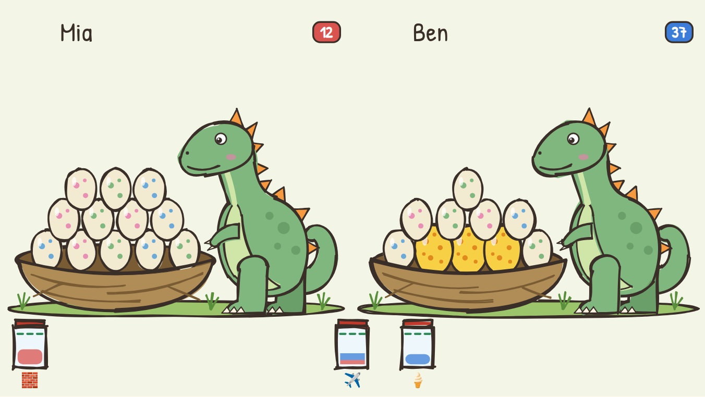
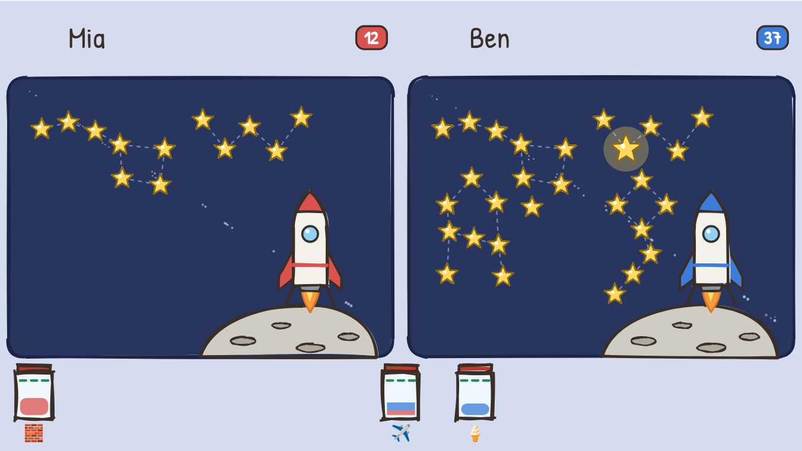

# family-board-card

## What it is

A custom Home Assistant Lovelace card that shows the kids' points from
[TaskMate](https://github.com/tempus2016/taskmate) (Home Assistant integration) as a hand-drawn-style picture (ornaments on a
tree, bricks in a brick tower, eggs in a dino nest, stars in a night sky), plus savings jars. It runs
on a landscape tablet in the living room. The kids tap it themselves; the card
is read-only and only navigates (tapping a kid opens their TaskMate view).
Everything shown to the kids is in German. Design:
`docs/superpowers/specs/2026-11-20-bonus-points-display-design.md`.





## Install

Production is Home Assistant in Docker Compose on one home server with a
persistent config volume; see `deploy/compose.yaml` for an example including
notes on HACS, pinned TaskMate, the non-admin kids user and the tablet kiosk
(landscape, fullscreen, screen always on).

The card is installed through [HACS](https://hacs.xyz) as a custom repository:

1. HACS → three-dot menu → Custom repositories → add
   `https://github.com/stempler/family-board` with type Dashboard.
2. Search for "Family Board Card" in HACS and download it. This needs at least
   one release (see [Release](#release)).
3. For dashboards in storage mode, HACS adds the resource by itself. For a
   dashboard in YAML mode, add `/hacsfiles/family-board/family-board-card.js`
   as a JavaScript module by hand.
4. Add the card to a dashboard (see [Card configuration](#card-configuration)).
5. Updates: HACS shows new releases. Update there, then reload the tablet.

## Card configuration

| Field | Default | Description |
|---|---|---|
| `type` | `custom:family-board-card` | Card type. |
| `overview_entity` | `sensor.taskmate_overview` | TaskMate overview sensor. |
| `rewards_entity` | `sensor.taskmate_rewards` | TaskMate rewards sensor (savings jars). |
| `kids` | required, non-empty | One entry per kid, see below. |
| `seasons` | christmas `12-01`..`12-26`, halloween `10-24`..`10-31`, easter `easter-7`..`easter+1` | Seasonal theme overrides; the first matching rule wins. `from`/`to` are `MM-DD` or `easter`, `easter-N`, `easter+N` (days relative to Easter Sunday, N from 0 to 60), inclusive. Forms may be mixed. Rules with only `MM-DD` ends may wrap the year end; rules with an Easter-relative end do not, and one whose `from` is after its `to` wherever Easter falls is a config error. `seasons: []` turns seasons off. A theme with its own seasonal scene (`christmas`, `halloween`, `easter`) shows one shared scene across the board; any other theme is used for every kid's half. |
| `reward_icons` | `{}` | Map of reward id or name to an emoji or `mdi:...` icon. Default: TaskMate's own MDI icon. |

`kids[]` entries:

| Field | Default | Description |
|---|---|---|
| `id` | required | TaskMate child id (see below). Each kid may appear only once. |
| `theme` | required | Favourite theme, any id from [Themes](#themes). Unknown themes fall back to `bricks`. |
| `colour` | TaskMate child colour | Accent colour for the kid. Without it the child's colour from TaskMate is used, else a built-in palette colour. |
| `tap_path` | none | Dashboard path (must start with `/`) opened when the kid is tapped. A kid that is not found in TaskMate is not tappable. |
| `show_number` | `true` | Show the point total as a small number chip at the right of the header. Set `false` to hide it. |

```yaml
type: custom:family-board-card
overview_entity: sensor.taskmate_overview
rewards_entity: sensor.taskmate_rewards
kids:
  - id: b803da068e6a4b21
    theme: dino
    colour: "#4caf50"
    tap_path: /taskmate-anna
  - id: 8e16ad66b23f404e
    theme: bricks
    tap_path: /taskmate-ben
    show_number: false
seasons:
  - theme: christmas
    from: "12-01"
    to: "12-26"
reward_icons:
  Eis: "🍦"
  Bildschirmzeit: mdi:television
```

The child id is TaskMate's internal id, not the name: Developer Tools → States →
`sensor.taskmate_overview` → attribute `children`, field `id` of each entry.
Adding the card in the dashboard editor pre-fills the ids of all TaskMate
children.

Installed through HACS, the card resource is `/hacsfiles/family-board/family-board-card.js`
(type: JavaScript module); see [Install](#install). The local dev setup uses
`/local/family-board/family-board-card.js`.

## Themes

Every kid's point total is drawn as items. Up to a theme's capacity every point
is one small item. Beyond that, as few small items as needed are replaced by
big ones (10, 50, 100, 500 or 1000 points each, the smallest unit that fits), so
the most small items stay. Examples with a capacity of 30: 31 points are 1 big
item (10) plus 21 small ones; 301 points are 6 big items (50) plus 1 small one.
Items never move when a point is added; when small items merge into a big one,
only the new big item pops in. `show_number` adds the exact total as a number
chip at the right of the header. Chess counts its own way: games won and pieces captured,
with shelf trophies worth 5, 25 and 125 games.

| Id | Name | What the kid sees |
|---|---|---|
| `christmas` | Weihnachten | Ornaments on a Christmas tree; falling snow. Season scene: one big tree per kid in a snowy landscape. |
| `bricks` | Bausteine | A tower of bricks. |
| `dino` | Dino | Eggs in a nest with a whole dino standing beside it. |
| `wizard` | Zauberschule | Gems filling an hourglass in a wizard's tower room, with an owl and a candle. |
| `racing` | Rennstrecke | Medals and trophies on a shelf and podium; a race car drives in from the left, stops at the finish line and drives out to the right. |
| `space` | Weltraum | Yellow stars in constellations; 10 of them become one bigger, glowing star at a random-looking spot. A rocket on the moon, an occasional comet. |
| `dog` | Hund | Badges and bones at a dog house with a pup. |
| `chess` | Schach | 16 points are 1 won game, shown as a toppled king on a shelf (more than 10 wins merge into trophies worth 5); the remaining points of the current game (points mod 16) are captured opponent pieces beside a top-down chessboard showing a real game position. |
| `halloween` | Halloween | Candy in a pumpkin bucket. Season scene: a spooky night with a ghost. |
| `easter` | Ostern | Painted eggs in a basket on a meadow with a bunny. Season scene: one basket per kid. |

`christmas`, `halloween` and `easter` also have a season scene (see `seasons`
above); all others are favourites only. Preview them with `mise run dev`: the
playground has a theme picker per kid and a "Saison" switch: "nach Datum" (the
default) uses the date field with seasons on, "keine" sets today and turns
seasons off, and each season option sets a date inside that season.

### Animations

Every theme has a little ambient animation (snow, twinkling stars, a wagging
tail, ...). It is pure CSS (`@keyframes` on `transform` and `opacity`), no
timers, and it is deterministic: the same input gives the same picture. A board
keeps to about 60 animated elements. Under `prefers-reduced-motion: reduce`
all ambient animation and the drop of a new item stop, and the still picture
looks complete.

### Gallery

`mise run dev` also serves `/gallery.html`, with every theme (and each season
scene) side by side. `mise run gallery:shots` screenshots it with reduced
motion into `dev/screenshots/` (or `$FB_SCREENSHOT_DIR`), which is handy for
reviewing all themes in one go.

### Adding a theme

1. Copy [`docs/theme-template.ts`](docs/theme-template.ts) to `src/themes/<id>.ts` (id: English, lowercase), fix the imports as its header says and replace `template`. Set `label` to the German display name. It uses the shared helpers (`src/draw/units.ts`, and `src/draw/season.ts` for season scenes), the `item()` wrapper, `ctx.groups` and a tiny animation.
2. Register it in `THEMES` in `src/themes/registry.ts`. That is the only list: the playground, the gallery, the Home Assistant browser check and the snapshot tests read it.
3. Add `tests/themes/<id>.test.ts` calling `runThemeContract(theme)` (and `runSeasonContract(theme)` for a seasonal theme) plus theme-specific checks. The contract covers the css rules:
   - every `@keyframes` name and class starts with `fb-<id>-`;
   - rules set only `animation-name`, `animation-timing-function`, `transform-origin` and `transform-box`; duration, delay and iteration come from the shared `.fb-anim` rule through `--t` and `--d`;
   - animated elements carry `class="fb-anim fb-<id>-..."`, 1 to 30 per half (a season scene at most 60), never together with `fb-item`.

   Also: only escaped text (`esc`) and `num` for numbers, everything inside the half, and scenery drawn after the items with its own sketch key (`${seedKey}:<name>`) so adding an item never re-wobbles it. A theme that counts items differently (chess) implements `items(points, prev)`.
4. Seasonal theme only: add a rule to `DEFAULT_SEASONS` in `src/config.ts` (the snapshot test, the gallery and the playground take the season date from it), mark each kid's object with `seasonKid()` and update the `seasons` row of the [configuration table](#card-configuration), which lists the default rules by hand. Do this before writing the snapshots, so the season scene snapshot is written too.
5. Add the theme to a list in `FIVE_KID_BOARDS` in `tests/snapshots.test.ts` (a guard test fails until you do). A board holds at most five kids; when the lists are full, start a new list, which gets its own `five-kids-<n>.svg`. Existing lists are never reshuffled.
6. Write the snapshots: `mise run test -- -u tests/snapshots.test.ts` (and check that no other snapshot changed).
7. Add a row to the theme table above, with the same name as `label`.
8. Look at it: `mise run dev` (playground, `/gallery.html`), `mise run gallery:shots`, `mise run ha:screenshot`. The gallery and the browser check pick the theme up by themselves.

## Tablet: back to the picture (open item)

Tapping a kid opens the TaskMate view (`tap_path`), and **nothing brings the
tablet back to the picture yet**. TaskMate's kiosk card only returns to its own
face picker after its idle `timeout` (or shows its own ambient mode); it has no
option to leave for another view or URL, and leaving the dashboard just locks
it. Options, still to decide:

- Kiosk browser idle reload: e.g. Fully Kiosk Browser "Timer to Reload/Go to
  Start URL" with the board as start URL.
- browser_mod: navigate back to the board after an idle time.
- The "Zurück" button card in the task view (as in the dev dashboard), which
  needs a kid to tap it.

## Local development

Tools come from [mise](https://mise.jdx.dev).

```sh
mise install
npm ci
mise run dev      # theme playground (no Home Assistant needed), gallery at /gallery.html
mise run test     # unit tests
mise run ha:up    # local Home Assistant with TaskMate, the card and demo data
```

Other tasks: `typecheck`, `build`, `gallery:shots`, `ha:down`, `ha:reset`, `ha:seed`, `ha:screenshot`, `fixtures:capture`.

### Snapshot tests

`tests/snapshots.test.ts` renders whole boards for every theme and season scene
and compares them with the SVG files in `tests/__snapshots__/svg/`.

- Rendering is deterministic, so any difference is a visible change to the
  board.
- A refactor must leave the snapshots untouched.
- The files hold one SVG element per line (only the test's serialisation; the card's output is a single
  line). To review a change, open the `.svg` in a browser to see it, or expand the diff in the PR:
  the files are marked `linguist-generated` in `.gitattributes`, so GitHub collapses them by default, but
  the diff is still readable once expanded.
- `tests/__snapshots__/svg/` must contain exactly the files the test writes; a test fails on orphans.
- For an intended visual change, run `mise run test -- -u`, open the changed
  `.svg` files in a browser and commit them with the change.
- In CI, missing snapshots fail the run instead of being written.

### Local Home Assistant

`mise run ha:up` builds the card, starts Home Assistant in Docker
(`dev/ha/compose.yaml`, config in `dev/ha/config/`), and sets it up on the
first run.

- **Open:** http://localhost:8123/family-board/board
- **Login:** `dev` / `dev`. This user is created on the first run, together
  with a long-lived token in `dev/ha/.token` that the scripts use.
- **Dashboard "Family Board"** (in the sidebar):
  - **Board:** the card with the demo kids Mia (`bricks`) and Ben (`dino`).
  - **Aufgaben:** the TaskMate kiosk card. Tapping a kid's half on the board
    opens this view, and "Zurück" goes back.
- **Demo data:**
  - TaskMate with Mia and Ben, a few chores and rewards, and some starting
    points.
  - The kid ids are printed at the end of `ha:up`/`ha:seed`
    (`kids: Mia=…, Ben=…`).
- **Give points:** Developer tools → Actions → `taskmate.add_points` with
  `child_id`, `points` and `reason`. The board updates live.
- **Card changes:** run `mise run build` and reload the page with the cache
  bypassed (Ctrl+Shift+R). `dist/` is mounted into Home Assistant as
  `/local/family-board/`.
- **Stop or reset:**
  - `mise run ha:down` stops Home Assistant and keeps its data.
  - `mise run ha:reset` deletes the config and the token, so the next
    `ha:up` starts fresh. Run it once if your local Home Assistant was seeded
    before the demo jar was renamed to `Bausteine-Set`; otherwise `ha:seed`
    adds the jar a second time under the new name.

`ha:seed` overwrites the dev dashboard `/family-board` with the demo config, so
edits made to it in the UI are lost on the next seed.

`ha:screenshot` opens the board in the local Home Assistant with Playwright (in
Docker, `mcr.microsoft.com/playwright`), checks the tap navigation, a new item
after `taskmate.add_points`, the Christmas scene, every favourite theme (both
kids on it, seasons off, animated) and every season scene, and writes
screenshots (`ha-theme-<id>.png`, `ha-season-<id>.png`, ...) to
`dev/screenshots/` (or `$FB_SCREENSHOT_DIR`). Each run gives Mia one more point.

## Updating TaskMate

1. Bump `taskmate.version`.
2. `mise run ha:reset && mise run ha:up`.
3. `mise run fixtures:capture`.
4. `mise run test`.
5. Read the TaskMate release notes.

## Release

```sh
git tag vX.Y.Z && git push --tags
```

The `Release` workflow runs typecheck, tests and build, then creates a GitHub
release with `dist/family-board-card.js` attached.

## License

[MIT](LICENSE). The built card bundles Lit, Rough.js and the font Patrick Hand,
each under its own licence: see [THIRD-PARTY-NOTICES.md](THIRD-PARTY-NOTICES.md).
